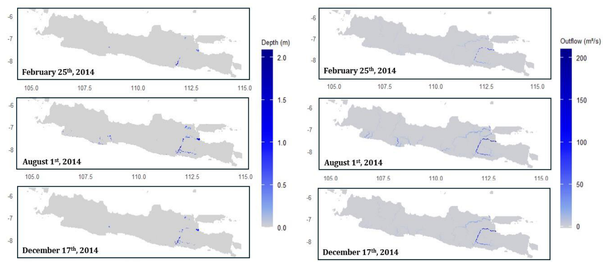
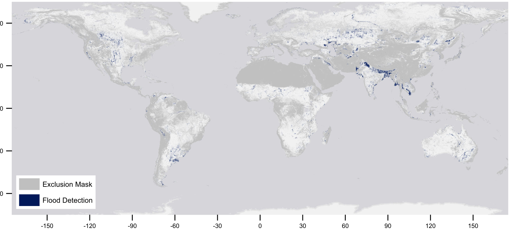
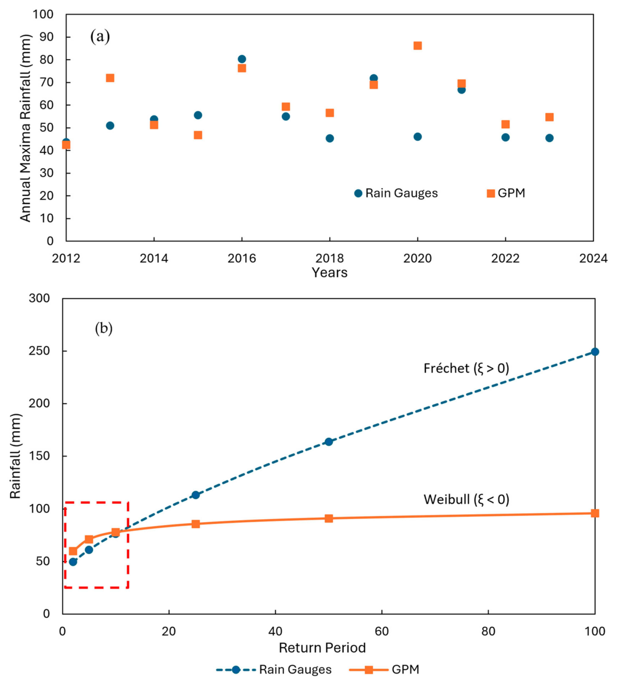
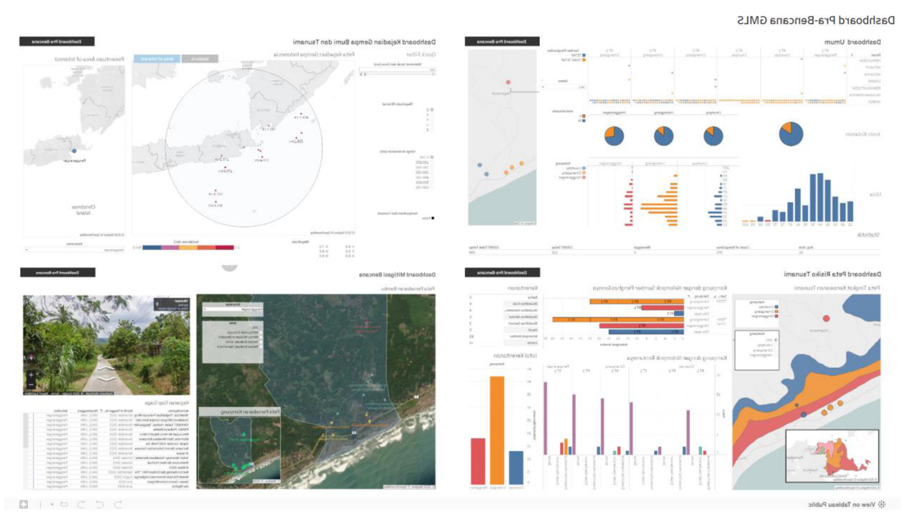
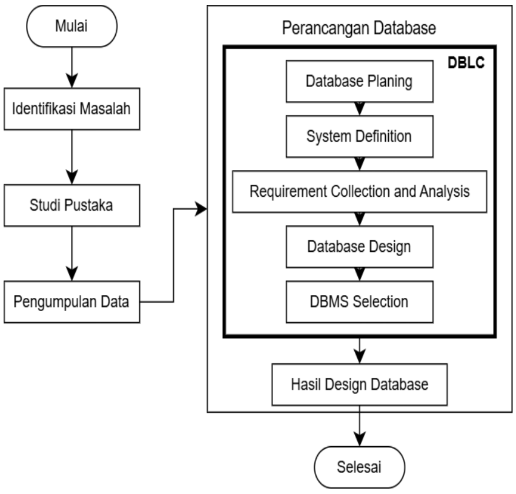
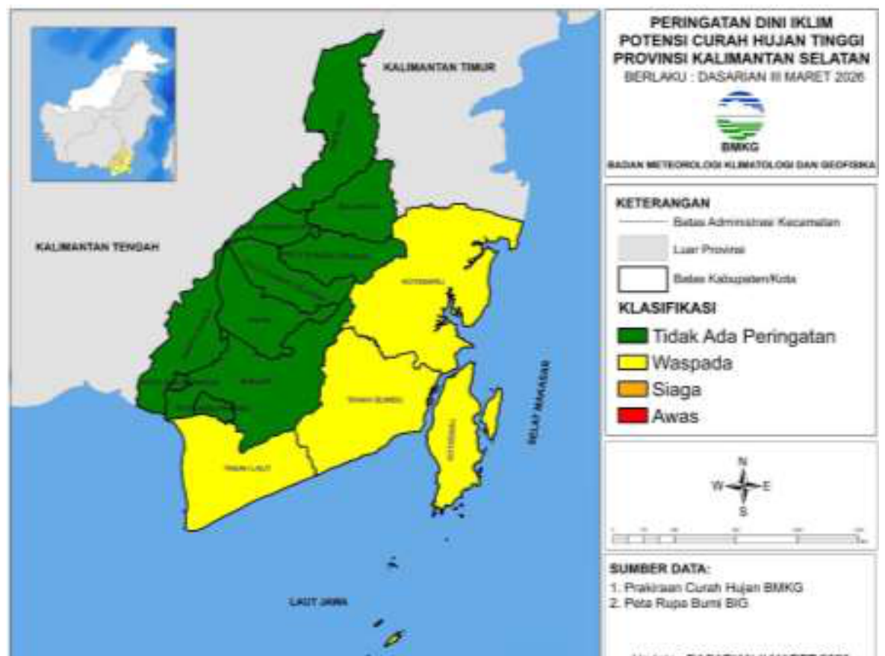

# Usulan Visualisasi BAB I–III

Ini hasil pemindaian cepat 72 PDF di `DOCS/skripsi/referensi/pdf`. Dari ratusan gambar, hanya delapan yang dipilih karena langsung mendukung kalimat yang sudah ada di naskah. Gambar yang hanya bersifat umum tidak diambil, misalnya alur tinjauan pustaka, statistik publikasi, contoh antarmuka sistem lain, atau grafik SUS.

Semua gambar berasal dari referensi yang **sudah dikutip** di Daftar Pustaka, jadi tidak ada sumber baru. Nomor rujukan `[n]` di bawah mengikuti Daftar Pustaka skripsi saat ini. Setiap gambar yang dipakai perlu diberi keterangan sumber di bawahnya, misalnya `Sumber: Shafiya dkk. [4]`.

| No | Berkas | Bab / Subbab | Prioritas |
|---|---|---|---|
| V1 | `V1_shafiya2025_debit_sungai_jawa.png` | BAB I, 1.1 Latar Belakang | Tinggi |
| V2 | `V2_misra2025_peta_banjir_global_sentinel1.png` | BAB II, 2.2.2 Sentinel-1 | Tinggi |
| V3 | `V3_ansori2026_gpm_meremehkan_hujan_ekstrem.png` | BAB II, 2.2.4 GPM IMERG | Tinggi |
| V4 | `V4_upadhyay2022_pipeline_sentinel1.png` | BAB II, 2.2.2 Sentinel-1 | Sedang |
| V5 | `V5_tilung2025_situs_gmls.png` | BAB III, 3.1.1 Profil GMLS | Tinggi |
| V6 | `V6_wong2024_dasbor_prabencana_gmls.png` | BAB III, 3.1.2 Aplikasi dalam Kerja Sama GMLS dan UMN | Tinggi |
| V7 | `V7_syaddam2025_tahapan_dblc.png` | BAB II, 2.3.1 DBSDLC | Tinggi |
| V8 | `V8_bmkg2026_peta_pdcht_kalsel.png` | BAB III, 3.3.3 Pemeriksaan Dokumen (atau BAB I, 1.1) | Tinggi |

Kalau hanya mau sedikit, ambil **V1, V2, V3, V5, V6, V7, dan V8**. V1 memberi BAB I satu visual tentang banjir di Jawa, V2 dan V3 menjawab "mengapa tiga satelit", V5 dan V6 menjawab "siapa GMLS", V7 untuk metode, dan V8 untuk dasar aturan peringatan.

**Pemeriksaan ulang.** Setelah pemindaian pertama, semua halaman di semua PDF dipindai ulang. Pemindaian ini juga mencakup PDF yang keterangan gambarnya tidak terbaca (Peraturan BMKG, Buletin Iklim BMKG, Syaddam, Gujjala, Dev 2022). Hasilnya ada tambahan V7 dan V8. Yang diperiksa tetapi tidak diambil:
- Peraturan BMKG No. 9/2022: lampirannya hanya format teks peringatan, tanpa visual.
- Buletin Iklim Sumatera Selatan: wilayahnya tidak relevan.
- Gujjala: ternyata *sequence diagram* Delta Lake, bukan diagram tier.
- Tarpanelli: grafik tutupan awan dan *violin plot* yang terlalu padat.
- Klein: alur Global WaterPack terlalu teknis untuk BAB II.
- Wang, Dev, dan Kaptosv: arsitektur dan ERD sistem lain yang tidak menambah pemahaman.
- Gambar SUS dan usability: tidak dipakai menurut Pedoman 1.3.
- Kovács (arsitektur CDSE) dan Nascimento (tabel 5W1H) sempat diusulkan, tetapi dibuang atas keputusan Anda.
- Untuk BAB I juga dipertimbangkan peta sebaran gempa Tilung [21] (Fig. 8). Gambar ini tidak dipilih karena bertema gempa, padahal BAB I menekankan bahaya hidrometeorologi.
- Lestari (peta Geopark Bayah) memang di wilayah kajian, tetapi tidak ada di Daftar Pustaka. Kalau mau dipakai, rujukannya perlu ditambahkan dulu.

---

## V1. Peta debit dan kedalaman banjir sungai di Pulau Jawa



- **Sumber:** Shafiya, Kuntoro, Rohmat & Wijayasari (2025), *Development of Java Island-scale flood model using CaMa-Flood*, IOP Conf. Series: Earth and Environmental Science 1472, Figure 2, hlm. 6. Daftar Pustaka [4]. Berkas: `45_Shafiya_2025_...pdf`.
- **Letak:** BAB I, subbab 1.1 Latar Belakang, paragraf kedua, setelah kalimat "Pulau Jawa ... mengalami peningkatan frekuensi banjir rata-rata 13,18% per tahun sejak 2012, sementara keterbatasan penyimpanan dan pengelolaan data menyebabkan sebagian wilayah tidak memiliki data yang memadai untuk pemodelan banjir [4]."
- **Alasan cocok:** ini satu-satunya visual di referensi yang memperlihatkan banjir di Pulau Jawa, tempat wilayah kajian berada. Peta ini menunjukkan kedalaman genangan (kiri) dan debit sungai (kanan) pada tiga tanggal di tahun 2014, dengan debit dan genangan tertinggi pada Agustus. Gambar ini menguatkan alasan latar belakang bahwa bahaya hidrometeorologi di Jawa nyata dan berubah sepanjang tahun, sehingga datanya perlu disimpan berkala, bukan hanya per kejadian.
- **Catatan:** genangan utama di peta ada di Jawa Timur (Brantas, Bengawan Solo) dan Citanduy, bukan di Lebak. Di teks, tulis gambar ini sebagai gambaran skala Pulau Jawa, lalu sambungkan ke kebutuhan data per wilayah di Lebak Selatan.

## V2. Peta banjir global dari 10 tahun data Sentinel-1



- **Sumber:** Misra dkk. (2025), *Mapping global floods with 10 years of satellite radar data*, Nature Communications, Fig. 1, hlm. 3. Daftar Pustaka [32]. Berkas: `32_Misra_2025_...pdf`.
- **Letak:** BAB II, subbab 2.2.2 Sentinel-1, di paragraf tentang kemampuan radar menembus awan (juga dirujuk di Tabel 2.2, baris "Keunggulan").
- **Alasan cocok:** ini bukti visual bahwa SAR Sentinel-1 bisa memetakan banjir di seluruh dunia termasuk Indonesia, sekaligus menunjukkan wilayah yang sulit dideteksi (abu-abu gelap). Gambar ini memperkuat alasan memilih Sentinel-1 untuk pemantauan genangan di Lebak Selatan yang sering berawan.

## V3. GPM IMERG meremehkan hujan ekstrem (Jawa Timur)



- **Sumber:** Ansori & JBS (2026), *A comprehensive evaluation of GPM IMERG satellite rainfall data ... in East Java, Indonesia*, Sustainability, Figure 7, hlm. 15. Daftar Pustaka [10]. Berkas: `04_Ansori_2026_...pdf`.
- **Letak:** BAB II, subbab 2.2.4 GPM IMERG, di kalimat keterbatasan "meremehkan hujan ekstrem harian [10]" (Tabel 2.2, baris "Keterbatasan").
- **Alasan cocok:** studinya di Indonesia (Jawa). Grafik (b) menunjukkan GPM mendekati alat penakar hujan pada periode ulang pendek, tetapi jauh di bawahnya pada hujan ekstrem. Ini menjelaskan kenapa peringatan berbasis ambang BMKG perlu dibaca sebagai indikasi, dan mendukung bagian keterbatasan. Penguji juga cenderung menghargai bukti dari wilayah Indonesia.

## V4. Tahapan pra-pemrosesan Sentinel-1


- **Sumber:** Upadhyay dkk. (2022), *A flexible multi-temporal and multi-modal framework for Sentinel-1 and Sentinel-2 analysis ready data*, Remote Sensing, Figure 3, hlm. 6. Daftar Pustaka [14]. Berkas: `52_Upadhyay_2022_...pdf`.
- **Letak:** BAB II, subbab 2.2.2 Sentinel-1, setelah penjelasan bahwa citra radar memiliki distorsi radiometrik dan geometrik [13].
- **Alasan cocok:** diagramnya sederhana dan langsung menjelaskan langkah kalibrasi radiometrik, *speckle filtering*, koreksi medan, dan pemotongan wilayah. Langkah ini sejalan dengan tier RAW → ALIGNED → DESPECKLED pada sistem, jadi pembaca BAB IV lebih mudah memahami kenapa ada tier berurutan dan *lineage*.
- **Catatan:** pilih V4 **atau** V2 bila subbab 2.2.2 terasa terlalu banyak gambar. V2 lebih kuat sebagai bukti, V4 lebih kuat sebagai penjelasan proses.

## V5. Situs resmi GMLS


- **Sumber:** Tilung, Prastomo & Reza (2025), *Analysis and visualization of earthquake patterns (2021–2025) in the South Lebak region based on the dataset from Gugus Mitigasi Lebak Selatan*, Proc. CONMEDIA 2025, Fig. 9, hlm. 6. Daftar Pustaka [21]. Berkas: `50_Tilung_2025_...pdf`.
- **Letak:** BAB III, subbab 3.1.1 Profil GMLS (atau di subbab Observasi, saat menyebut gmls.org sebagai sumber observasi).
- **Alasan cocok:** gambar ini memperkenalkan objek penelitian secara visual dan menunjukkan bahwa GMLS adalah organisasi yang aktif dan punya kanal resmi. Gambar ini juga mendukung prasyarat legalitas dan lama beroperasi. Sumbernya jurnal karya dosen UMN tentang GMLS, jadi sekaligus memperkuat syarat rujukan dosen UMN.
- **Catatan:** salah satu penulisnya, A. F. Reza, adalah Ketua GMLS. Alternatifnya, ambil tangkapan layar gmls.org sendiri dan tulis sumbernya "gmls.org, diakses [tanggal]".

## V6. Dasbor pra-bencana tsunami GMLS



- **Sumber:** Wong dkk. (2024), *Perancangan dasbor pra-bencana tsunami di Gugus Mitigasi Lebak Selatan: Visualisasi dan mitigasi di Panggarangan*, G-Tech, Gambar 5, hlm. 9. Daftar Pustaka [22]. Berkas: `56_Wong_2024_...pdf`.
- **Letak:** BAB III, subbab 3.1.2 Aplikasi dalam Kerja Sama GMLS dan UMN, di dekat Tabel 3.1. Bisa juga di 3.1.3 Sistem yang Sedang Berjalan.
- **Alasan cocok:** ini sistem yang sudah ada di GMLS (dasbor Tableau berbasis data SIGAP DESA/data_humanity) dan hanya mencakup gempa-tsunami serta kependudukan. Gambar ini memperlihatkan celah yang diisi penelitian ini, yaitu belum adanya data hidrometeorologi, sehingga mendukung batas sistem pada Tabel 3.1 dan temuan observasi.

## V7. Tahapan Database Life Cycle



- **Sumber:** Syaddam dkk. (2025), *Desain model relational database perpustakaan SMP Negeri 13 Tarakan menggunakan metode Database Life Cycle*, Jurnal Terapan Teknologi Informasi, Gambar 1, hlm. 3. Daftar Pustaka [53]. Berkas: `63_Syaddam_2025_...pdf`.
- **Letak:** BAB II, subbab 2.3.1 Database System Development Life Cycle (DBSDLC), setelah kalimat "Database Life Cycle juga telah dipakai untuk merancang basis data relasional ... [53], [54]."
- **Alasan cocok:** saat ini subbab DBSDLC hanya berisi teks. Diagram ini memperlihatkan urutan Database Planning → System Definition → Requirement Collection and Analysis → Database Design → DBMS Selection, sama dengan tahapan di naskah dan jalur Pedoman 1.3. Penguji jadi bisa melihat bahwa metode ini lazim dipakai dalam penelitian sejenis.
- **Catatan:** diagram ini hanya memuat 5 dari 11 tahap DBSDLC. Jelaskan di teks bahwa penelitian ini memakai tahapan lengkap (Gambar 3.2 dan Tabel 3.2).

## V8. Peta Peringatan Dini Curah Hujan Tinggi BMKG



- **Sumber:** Stasiun Klimatologi Kalimantan Selatan, BMKG (2026), *Peringatan dini cuaca dan iklim Provinsi Kalimantan Selatan periode Dasarian III Maret 2026*, Lampiran 2, Gambar 1, hlm. 5. Daftar Pustaka [58]. Berkas: `DP58_BMKG_2026_...pdf`.
- **Letak:** BAB III, subbab 3.3.3 Pemeriksaan Dokumen, di kalimat kriteria intensitas hujan BMKG [57], [58]. Alternatifnya BAB I, 1.1, sebagai contoh informasi BMKG yang belum spesifik ke lokasi warga.
- **Alasan cocok:** ini contoh nyata produk peringatan resmi BMKG dengan klasifikasi Waspada/Siaga/Awas, yang menjadi acuan aturan peringatan di sistem (ambang 50, 100, 150 mm). Peta ini juga menunjukkan bahwa peringatan resmi disajikan per wilayah kabupaten dan per dasarian, sehingga memperkuat masalah di latar belakang bahwa informasi yang diterima GMLS belum spesifik per kecamatan dan per hari.
- **Catatan:** wilayahnya Kalimantan Selatan, bukan Banten. Tulis di teks bahwa ini contoh format produk BMKG.

---

## Prompt untuk memperbarui BAB I–III

Salin prompt di bawah ke sesi baru setelah memilih gambar yang akan dipakai. Hapus baris gambar yang tidak jadi dipakai.

```text
Perbarui naskah skripsi di themonitor/DOCS/skripsi dengan menambahkan gambar dari
DOCS/skripsi/naskah/visualisasi/ (lihat USULAN_VISUALISASI.md untuk sumber dan letaknya).

Gambar yang dipakai:
- V1 -> BAB I subbab 1.1 Latar Belakang
- V2 -> BAB II subbab 2.2.2 Sentinel-1
- V3 -> BAB II subbab 2.2.4 GPM IMERG
- V5 -> BAB III subbab 3.1.1 Profil GMLS
- V6 -> BAB III subbab 3.1.2 Aplikasi dalam Kerja Sama GMLS dan UMN
- V7 -> BAB II subbab 2.3.1 DBSDLC
- V8 -> BAB III subbab 3.3.3 Pemeriksaan Dokumen
(tambahkan V4 -> BAB II 2.2.2 bila dipilih)

Ketentuan:
1. Naskah dibangkitkan dari DOCS/skripsi/bahan_naskah/build_skripsi.py (BAB I–III);
   jangan sunting SKRIPSI FINAL.docx secara manual. Ikuti cara figure yang sudah ada
   (fungsi gambar/caption seperti peta_wilayah dan alur_penelitian), dan beri nomor
   Gambar 1.x, 2.x, 3.x sesuai urutan, lalu geser nomor gambar sesudahnya.
2. Setiap gambar diberi keterangan "Sumber: <penulis> dkk. [n]" sesuai Daftar Pustaka,
   dan dirujuk di teks sebelum gambar muncul ("ditunjukkan pada Gambar 2.x").
3. Tambahkan satu atau dua kalimat yang menafsirkan gambar untuk konteks Lebak Selatan,
   jangan hanya menempelkan gambar.
4. Bangun ulang SKRIPSI FINAL.docx dengan alur biasa (build_skripsi.py -> transplant.py
   untuk halaman awal -> validasi XML -> difftxt.py), pastikan daftar gambar dan
   halaman awal tetap utuh, lalu laporkan perubahannya sebelum commit.
```
